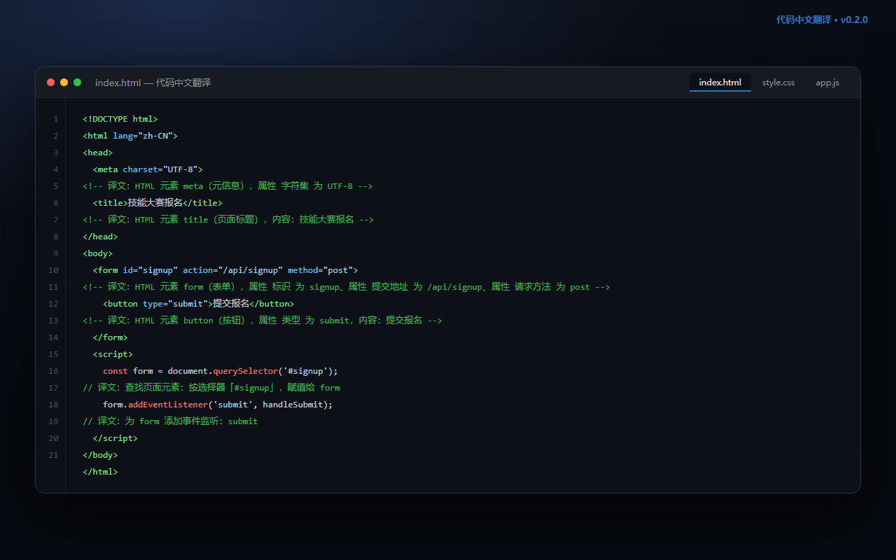

# 代码中文翻译（Code Chinese Translator）

[](LICENSE)
[](https://code.visualstudio.com/)
[](https://github.com/Lmc-2008/code-zh-translator/actions)

> 一个给英文代码自动加中文注释的 VS Code 扩展：离线、免费、开源。
>
> A VS Code extension that inserts Chinese comments under each line of code — fully offline and open source.



支持 **HTML / CSS / JavaScript / TypeScript / SQL / Python / Java / C / C++ / C# / Go / Rust** 等语言。

## 功能

- **逐行插入中文注释**：在每行代码下一行生成 `<!-- 译文：… -->`、`/* 译文：… */`、`// 译文：…`、`-- 译文：…`、`# 译文：…`，注释符号按语言自动切换。
- **侧边预览**：右侧面板左原文、右中文，可一键插入或移除。
- **HTML 内嵌代码识别**：`<script>` 用 JS 注释、`<style>` 用 CSS 注释，不会把 HTML 注释塞进脚本里。
- **重复执行不叠加**：旧的「译文」行自动替换。
- **一键移除**：清掉所有由扩展插入的注释。
- **完全离线**：本地词库 + 规则模板，代码不出本机。

## 效果

```sql
SELECT id, name FROM users WHERE age > 18;
-- 译文：从「用户」中查询：编号、姓名；条件：年龄 大于 18
```

```html
<div class="container">
<!-- 译文：HTML 元素 div（区块容器），属性 类名 为 container -->
  <a href="/login">登录</a>
<!-- 译文：HTML 元素 a（超链接），属性 链接地址 为 /login，内容：登录 -->
</div>
```

```css
.btn {
/* 译文：选择器「类名为 btn 的元素」的样式块 */
  display: flex;
/* 译文：显示方式：flex（弹性布局） */
}
```

```js
const add = (a, b) => a + b;
// 译文：定义箭头函数 add，参数：a、b，返回 a 加 b
```

## 快捷键

| 命令 | 快捷键 | 说明 |
| --- | --- | --- |
| 插入中文注释 | `Ctrl+Alt+T` | 选中行或整个文件 |
| 侧边预览 | `Ctrl+Alt+P` | 对照查看译文 |

## 安装

### VSIX 安装（推荐）

从 [Releases](https://github.com/Lmc-2008/code-zh-translator/releases/latest) 下载 `code-zh-translator-0.2.0.vsix`，然后：

```bash
code --install-extension code-zh-translator-0.2.0.vsix
```

也可以在 VS Code 扩展面板右上角 `...` → **从 VSIX 安装**。

### 从源码安装

把 `vscode-extension/` 复制到 `%USERPROFILE%\.vscode\extensions\codezh.code-zh-translator-0.2.0`，重启 VS Code。

安装后执行 `Ctrl+Shift+P` → `Reload Window` 重新加载。

## 支持语言

| 语言 | 覆盖内容 |
| --- | --- |
| HTML / Vue / Svelte | 标签、属性、自闭合元素、内嵌 script/style |
| CSS / SCSS / Less | 选择器、属性声明、媒体查询、关键帧、常用值 |
| JavaScript / TypeScript | 变量、函数、箭头函数、DOM 查询、事件、数组方法、async/await |
| SQL | SELECT / INSERT / UPDATE / DELETE / JOIN / WHERE / GROUP BY / ORDER BY / LIMIT / 事务等 |
| Python | def / class / if / for / while / import / print / with / try-except |
| Java / C / C++ / C# / Go / Rust 等 | 函数、变量、条件、循环、调用 |

## 自定义词库

编辑 `vscode-extension/glossary.json`（安装后为扩展目录下的 `glossary.json`）：

- `keywords` / `words`：语句关键字与标识符常用词
- `html.tags` / `html.attrs`：HTML 标签与属性
- `css.props` / `css.values` / `css.colors`：CSS 属性、取值、颜色

改完重新加载窗口生效。

## 项目结构

```text
.
├── vscode-extension/     # 扩展本体（package.json / extension.js / engine.js / insertCore.js / glossary.json）
├── shared/
│   ├── engine/           # 翻译引擎源码
│   └── glossary.json     # 词库源文件
├── tests/                # 单元测试（引擎 / 注释插入 / 扩展激活）
├── tools/                # 打包脚本
├── scripts/install.bat   # Windows 一键安装脚本
├── dist/                 # 构建产物（.vsix / .zip）
└── .github/workflows/    # CI
```

## 开发

```bash
# 运行测试（需要 Node.js 18+）
node tests/test-translator.js
node tests/test-insert-core.js
node tests/test-extension.js

# 打包 VSIX（Windows / PowerShell）
powershell -ExecutionPolicy Bypass -File tools/build-vsix.ps1
```

## 说明

- 翻译采用**词库 + 规则**的离线实现，用于辅助理解代码结构，不保证逐字精准；无法识别的复杂表达式会保留原文。
- 扩展不发起任何网络请求，不上传代码。

## License

[MIT](LICENSE)

---

## English

**Code Chinese Translator** is a VS Code extension that inserts Chinese comments under each line of code — fully offline, no network, no code upload.

- Supports HTML / CSS / JavaScript / TypeScript / SQL / Python / Java / C / C++ / C# / Go / Rust
- Commands: `Ctrl+Alt+T` insert comments, `Ctrl+Alt+P` side-by-side preview
- Recognizes `<script>` / `<style>` blocks inside HTML and picks the right comment syntax
- Local glossary + rule engine, MIT licensed

Install from [Releases](https://github.com/Lmc-2008/code-zh-translator/releases/latest), or build with `tools/build-vsix.ps1`.
